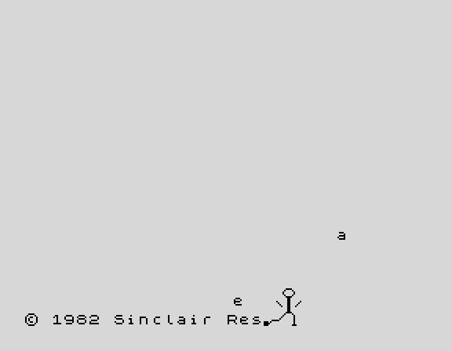

# Sinclair Kick, machine code

The same joke as the BASIC version, done properly in Z80 for the 48K ZX Spectrum. Fifty frames a second, pixel positioned, and the letters come at you.



**[Watch it in your browser](https://mindbox77.github.io/zx-spectrum-games/play.html?g=sinclair-kick-asm)**

The boot screen sits there for a couple of seconds. A stickman strolls in from the right and kicks every letter off the copyright line. Each one flies off in its own direction, and some zoom towards you, growing from one to four times size before they pass the screen. The copyright symbol bounces off the left edge and lands on his head. He reels, falls, lies there, gets up and walks off, then leans back in from the left and waves. After a pause it starts again. Any key skips the pause, SPACE returns to BASIC.

## Running it

Load the tape from [Releases](https://github.com/mindbox77/zx-spectrum-games/releases) in your emulator of choice, or on the real thing via a DivMMC or similar. The loader does `CLEAR 32767` and starts the code at 32768. 48K is enough.

## Building from source

`kick.asm` is the whole thing, one file, no includes. `tools/build.sh` at the top of the repo builds it, or by hand:

```
pasmo --tapbas --name kick kick.asm kick.tap
```

## Notes

Positions and velocities are 9.7 fixed point, one pixel is 128, and the scale of a zooming letter is 8.8 with 1.0 being 256. Everything is drawn with XOR, so drawing a thing twice erases it, and each frame erases the moving things, updates them and draws them again. Shifting a row of pixels to an arbitrary x uses two 256 byte lookup tables per shift amount, and the twelve stickman frames are preshifted into all eight positions at startup so drawing him is a straight copy.

The ROM font is the typeface, read straight from the ROM at 15616, which is why the kicked letters are the real ones.

The flight of the copyright symbol was tuned in a fixed point simulation so that it lands on his head after forty frames. If he has moved on by then it misses and he carries on regardless.

Damian Cooper, 2026
