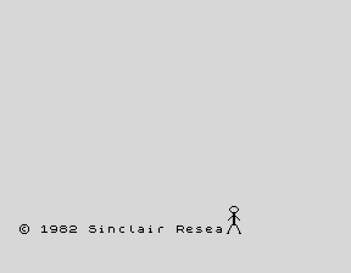

# Sinclair Kick

A party piece for the 48K ZX Spectrum, written in Sinclair BASIC. The boot screen gets what is coming to it.



**[Watch it in your browser](https://mindbox77.github.io/zx-spectrum-games/play.html?g=sinclair-kick)**

You switch on. There is the familiar line at the bottom, `© 1982 Sinclair Research Ltd`, as it has been on every Spectrum since the first one. A couple of seconds later a stickman strolls in from the right and starts kicking the letters off the end of it, one at a time. They fly up, tumble over and drop off the screen.

He gets as far as the copyright symbol. It does not go quietly: it bounces up the edge of the screen, hangs for a moment, and lands on his head. He goes down, stays down, gets up and walks off. Then he leans back in from the left and waves.

After a short pause it all happens again. Any key skips the pause, BREAK stops it.

## Running it

Load the tape from [Releases](https://github.com/mindbox77/zx-spectrum-games/releases) in your emulator of choice, or on the real thing via a DivMMC or similar. It is plain BASIC with nineteen UDGs, so it runs on anything from a rubber key 48K upwards.

## Building from source

`KICK.bas` is the plain text listing. `tools/build.sh` at the top of the repo builds it, or by hand:

```
zmakebas -a 10 -n KICK -o KICK.tap KICK.bas
```

## Notes

The letters are printed with `OVER 1`, so the same `PRINT` draws a thing and rubs it out again, and each one in flight is just a row, a column and two velocities with a bit of gravity. The stickman is three rows of UDGs, two wide, with alternate leg pairs for the walk and a third for the kick.

The path the copyright symbol takes to land on his head is a `DATA` list of row and column pairs, read back one step at a time, which is why it always lands.

Damian Cooper, 2026
