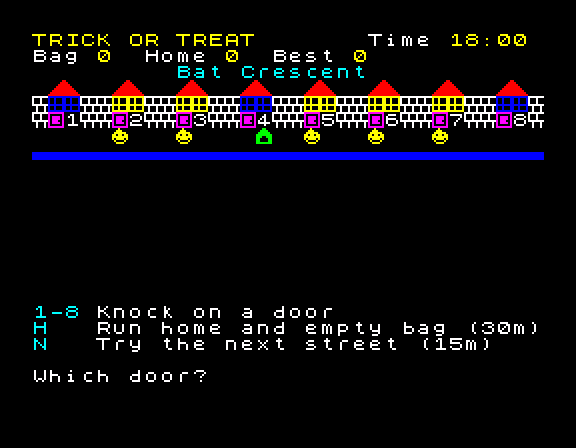

# ZX Spectrum Games & Fun

Small games for the 48K ZX Spectrum, written in Sinclair BASIC and Z80 assembly.



**[Play them in your browser](https://mindbox77.github.io/zx-spectrum-games/)** or grab the tapes from [Releases](https://github.com/mindbox77/zx-spectrum-games/releases).

## Why

I grew up on this machine and I still think it is the best teaching computer ever made. You turn it on and you are in BASIC. Everything the hardware can do is a keyword away. These are the sort of games I would have typed in from a magazine in 1984, except now they live in git, build on every push and run in a browser.

Each one is small enough to read in a sitting. That is the point. If you want to see how a push your luck mechanic works, or how to drive the beeper, or how UDGs are laid out, the whole thing is right there in a single listing with no framework in the way.

## The games

| Game | Where | What it is |
| --- | --- | --- |
| [Trick or Treat](Basic/trick-or-treat/) | Basic | A Halloween game of nerve. Eight doors, one bag, midnight coming. |

More as they get finished.

## Layout

```
Basic/      Proper games in Sinclair BASIC, one folder each
Fun/        Toys and party pieces, also BASIC, not quite games
Assembly/   Z80 machine code, built with pasmo
docs/       The GitHub Pages site (index, play page, stylesheet)
tools/      build.sh, run.sh, shot.sh
```

Every game folder holds the plain text source, a README and a screenshot. Nothing binary is committed. Tapes are built from source on every push and attached to a release when I tag.

## Building

You need `zmakebas` and `pasmo`, both of which are ordinary Debian and Ubuntu packages.

```
tools/build.sh                  # every game -> build/<slug>.tap, site -> build/site/
tools/run.sh trick-or-treat     # build, then load one game in Fuse
tools/shot.sh trick-or-treat space   # headless Fuse, LOAD "", press keys, screenshot
```

`build.sh` reads the first heading and paragraph of each game's README to fill in the site catalogue, so a game appears on the Pages site the moment its folder has a README and a `.bas` or `.asm` in it. Assembly games can drop a file called `machine` containing `128` into their folder if they need the 128K.

The site uses [JSSpeccy 3](https://github.com/gasman/jsspeccy3) for emulation. It is GPL and this repo is Creative Commons, so the build fetches it from its release zip rather than vendoring it. Set `JSSPECCY_ZIP` to a local copy if you are offline.

## Conventions

BASIC source is the plain text format that zmakebas and bas2tap read: one numbered line per line, keywords in upper case, `GO TO` and `GO SUB` with the space, UDGs referred to as `CHR$ 144` and up rather than embedded. It diffs properly, which is the whole reason for keeping it as text.

Autostart is always line 10. No REM lines in shipped listings; the README is the documentation.

Assembly follows the same rules as [zxdesk](https://github.com/mindbox77/zxdesk): pasmo, `.asm` plus `.inc` modules, measured numbers in the commit messages.

One commit per verified piece of work. Verified means it has been loaded in Fuse with the real 48K ROM and played, not just tokenised.

## Licence

Everything here is my own work. Nothing is derived from anyone else's code.

The games, their source and this documentation are released under [CC BY-NC-SA 4.0](LICENSE). Play them, share them, learn from them, remix them, credit me and keep the same licence. Do not sell them.

The toolchain, emulators and Sinclair ROMs are not part of this repo and have their own licences.

Damian Cooper
